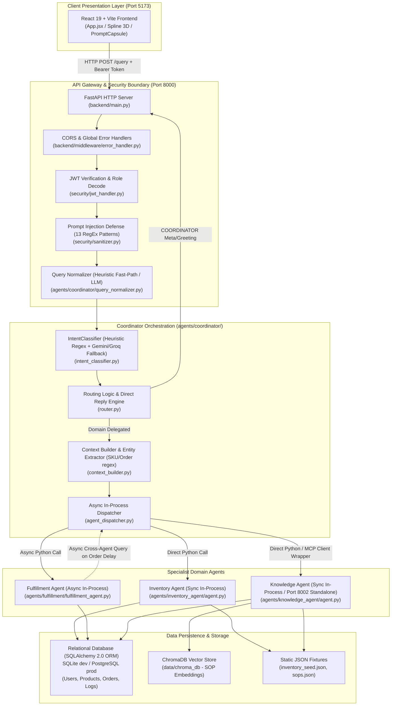
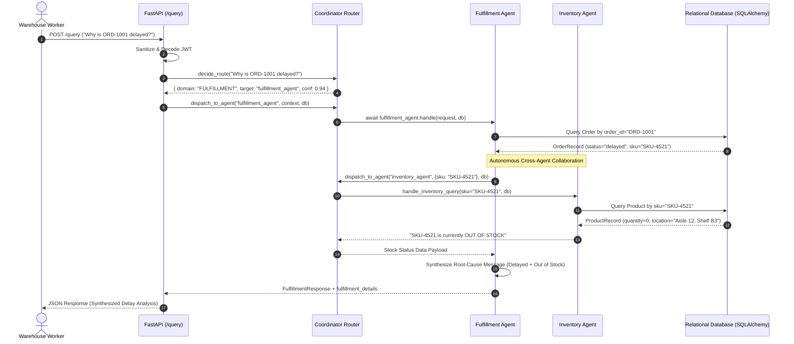
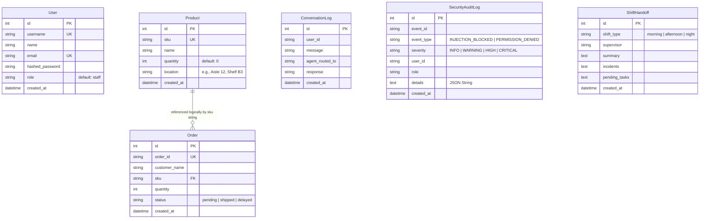
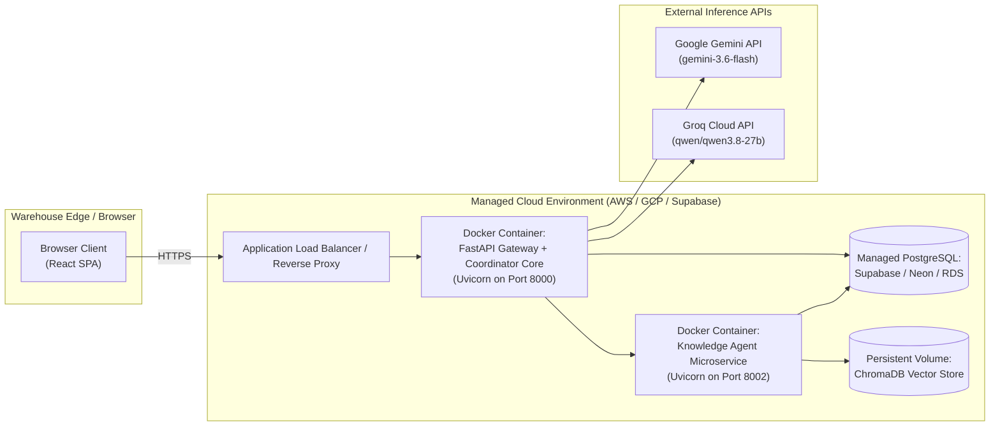

# IntelliWMS — System Schema & Commercialization Plan

**Document Version:** 1.0.0  
**Project:** IntelliWMS (Agentic AI Warehouse Management System)  
**Repository Branch:** `Test_Rashmika` (Commit: `493a928`)  
**Document Purpose:** System Architecture Schema, Technical Specification, and Commercialization Proposal for Academic Proposal & Final Assessment  
**Authorship / Role:** IntelliWMS Engineering Team  

---

## Document Overview & Boundary Definitions

This document details the actual system architecture, technical schemas, runtime communication patterns, database models, security enforcement mechanisms, and a commercialization proposal for **IntelliWMS**. 

Every technical specification in **Part 2** and **Part 8** is verified through direct static and dynamic inspection of the existing codebase. To preserve academic integrity and engineering accuracy, features and business constructs are rigorously classified under one of four unambiguous tiers:
* **Implemented (✅):** Fully functional, substantiated by live code, and verified through automated test suites.
* **Partially Implemented (🟡):** Present in the codebase with active functional elements, but lacking certain end-to-end attributes, schema fields, or edge-case handling.
* **Proposed / Planned (🟠):** Architecturally designed, documented, or scoped in project requirements, but not yet present in executable code.
* **Not Implemented (🔴):** Completely absent from the current codebase.

---

# PART 2 — SYSTEM SCHEMA

## 2.1 High-Level Architecture

The current IntelliWMS system implements an **Asynchronous Multi-Agent Gateway Pattern**. Natural language queries originate from a single-page React frontend, pass through a FastAPI application gateway where security and authentication checks are enforced, undergo intent classification and entity normalization, and are then dispatched to specialized domain agents.



### Architectural Flow Execution Sequence:
1. **Request Intake:** The React client transmits `POST /query` containing `{ "query": "...", "token": "..." }`.
2. **Security & Gatekeeping:** The gateway decodes the JWT, executes 13 prompt-injection regex heuristics, and records suspicious attempts to an audit log.
3. **Normalization:** `normalize_query()` bypasses LLMs for well-formed queries containing warehouse keywords (<1ms), reserving LLM rewrites solely for fragmented user inputs.
4. **Intent Classification:** `intent_classifier.py` evaluates domain intent (`INVENTORY`, `FULFILLMENT`, `KNOWLEDGE`, `COORDINATOR`). A deterministic regex scan executes in <1ms (threshold $\ge 0.80$). Ambiguous queries fallback to Google Gemini (`gemini-3.6-flash`) or Groq (`qwen/qwen3.8-27b`). Queries with confidence $<0.60$ default to `KNOWLEDGE`.
5. **Specialist Dispatch:** The dispatcher executes specialist functions directly in-process via Python modules rather than distributed network hops, minimizing serialization overhead.

---

## 2.2 Agent Architecture Schema

| Agent | Core Responsibility | Runtime Inputs | Runtime Outputs | Data Sources / Dependencies | Current Status |
| :--- | :--- | :--- | :--- | :--- | :--- |
| **Coordinator Agent** | Request authentication, injection detection, intent classification, entity extraction, and specialist dispatch. | `QueryRequest` payload containing user text string and optional JWT bearer token. | Structured JSON with `status`, `agent_used`, `response`, `routing`, and `audit` telemetry. | `config/settings.py`, `security/`, `agents/coordinator/` logic, Gemini/Groq LLMs. | **Implemented (✅)** |
| **Inventory Agent** | Stock availability checks, physical bin coordinates, safety stock thresholds, and reorder alerts. | Raw query string, optional pre-extracted `sku`, `user_role`, active SQLAlchemy `Session`. | Human-readable stock summary string with SKU, location, quantity on hand, and replenishment warning. | `database/models.py` (`Product` table), `agents/inventory_agent/data/inventory_seed.json`. No LLM required. | **Implemented (✅)** |
| **Fulfillment Agent** | Order tracking, shipping confirmation, dispatch progress, and delayed order cross-checks. | `FulfillmentRequest` (`query`, optional `order_id`, `user_id`, `role`), active DB `Session`. | `FulfillmentResponse` (`success`, `order_id`, `intent`, `message`) plus structured `fulfillment_details`. | `database/models.py` (`Order` table), Dedicated Fulfillment Gemini Client (`FULFILLMENT_GEMINI_API_KEY`). | **Implemented (✅)** |
| **Knowledge Agent** | Warehouse Standard Operating Procedures (SOPs), safety rules, compliance verification, and shift handoffs. | `query` string, `user_role`, contextual dictionary, optional DB session. | Standardized dictionary containing synthesized `response`, `source`, `entities`, and `rag_sources`. | `data/chroma_db` (ChromaDB Vector Store), `database/models.py` (`Product`, `ShiftHandoff`), `sops.json`. | **Implemented (✅)** |

---

## 2.3 Agent Communication Schema

A critical engineering finding in the current repository is the distinction between **documented protocol aspiration** and **actual runtime execution**:

### Runtime Communication Truth:
* **No Network MCP Transport:** The system does not transmit JSON-RPC 2.0 frames across HTTP SSE or STDIO pipes.
* **In-Process Python Dispatch:** `agents/coordinator/agent_dispatcher.py` handles communication by importing domain functions directly into the FastAPI execution process.
* **Bypassed Mock:** `mcp_servers/coordinator_client.py` contains a hardcoded mock method `_handle_fulfillment_query()` returning canned text for `#4521`. **This mock is never invoked** during live `/query` execution because `agent_dispatcher.py` overrides it with a direct call to `fulfillment_agent.handle()`.
* **Fulfillment $\rightarrow$ Inventory Collaboration:** When an order has `status == "delayed"` and contains an associated SKU, `FulfillmentAgent._call_inventory()` initiates a cross-agent query by invoking `agent_dispatcher.dispatch_to_agent("inventory_agent", ...)` asynchronously.



---

## 2.4 Database Schema

The database persistence layer is defined via **SQLAlchemy 2.0 Declarative Base** in `database/models.py`. It dynamically supports local SQLite (`sqlite:///./intelliwms.db`) for lightweight testing and cloud-hosted PostgreSQL (Supabase / Neon) with connection pooling (`pool_size=10, max_overflow=20, pool_recycle=300`).



### Table Definitions:

| Table Name | Purpose | Confirmed Columns | Confirmed Relationships |
| :--- | :--- | :--- | :--- |
| `users` | Role-based authentication and user profiles. | `id` (PK, Int), `username` (Unique, Str), `name` (Str), `email` (Unique, Str), `hashed_password` (Str), `role` (Str, default "staff"), `created_at` (DateTime). | No ORM ForeignKeys defined. |
| `products` | Warehouse SKUs, quantities on hand, and bin/rack locations. | `id` (PK, Int), `sku` (Unique, Str), `name` (Str), `quantity` (Int), `location` (Str), `created_at` (DateTime). | Logically joined via string match to `orders.sku`. |
| `orders` | Customer fulfillment, dispatch status, and product tracking. | `id` (PK, Int), `order_id` (Unique, Str), `customer_name` (Str), `sku` (Index, Str), `quantity` (Int), `status` (Str: "pending", "shipped", "delayed"), `created_at` (DateTime). | No explicit SQLAlchemy `ForeignKey` constraint on `sku`. |
| `conversation_logs` | Audit trail of user queries and agent responses. | `id` (PK, Int), `user_id` (Str), `message` (Str), `agent_routed_to` (Str), `response` (Str), `created_at` (DateTime). | Unbound standalone audit log table. |
| `security_audit_logs` | Log of security incidents, injection blocks, and access denials. | `id` (PK, Int), `event_id` (Str), `event_type` (Str), `severity` (Str), `user_id` (Str), `role` (Str), `details` (Text / JSON String), `created_at` (DateTime). | Standalone security log. |
| `shift_handoffs` | Shift transition operational notes and logs. | `id` (PK, Int), `shift_type` (Str), `supervisor` (Str), `summary` (Text), `incidents` (Text), `pending_tasks` (Text), `created_at` (DateTime). | Standalone operational log. |

### Future Schema Improvements:
1. **Explicit Relational Foreign Keys:** Convert `orders.sku` to an explicit `ForeignKey("products.sku")` with cascade rules.
2. **Order Delay Root Cause:** Introduce `delay_reason` (VARCHAR), `carrier_code` (VARCHAR), and `estimated_delivery` (TIMESTAMP) to `orders`.
3. **Multi-Tenancy Keying:** Introduce `warehouse_id` or `organization_id` (UUID) across all tables to support multi-site enterprise deployments.
4. **Active Logging Hook:** Connect `backend/routes/query.py` directly to `ConversationLog` to write conversation history on every execution.

---

## 2.5 API Schema

### Primary API Gateway (`backend/main.py` & `backend/routes/query.py` — Port 8000)

| Method | Endpoint | Purpose | Authentication | Current Status |
| :--- | :--- | :--- | :--- | :--- |
| `GET` | `/health` | Gateway service heartbeat, security status, and primary LLM model indicator. | None (Public) | **Implemented (✅)** |
| `POST` | `/auth/login` | Validates credentials against hashed passwords and returns signed JWT token. | None (Public) | **Implemented (✅)** |
| `POST` | `/auth/register` | Registers a new user with role assignment and returns JWT token. | None (Public) | **Implemented (✅)** |
| `GET` | `/auth/me` | Returns token claims, active user profile, and RBAC permission list. | Bearer Token Required | **Implemented (✅)** |
| `POST` | `/query` | Main Coordinator Agent conversational entrypoint. Validates token, sanitizes query, classifies intent, and delegates to specialist agents. | Optional Token (Permits Anonymous) | **Implemented (✅)** |
| `POST` | `/security/execute-action`| Role-Based Access Control sandbox executor validating role permissions. | Bearer Token Required | **Implemented (✅)** |
| `GET` | `/security/rbac-matrix` | Returns entire static RBAC capability dictionary. | None (Public) | **Implemented (✅)** |
| `POST` | `/security/test-injection`| Direct test harness for prompt injection regex validation. | None (Public) | **Implemented (✅)** |
| `POST` | `/security/test-permission`| RBAC evaluation endpoint checking if a role can execute a specific action. | None (Public) | **Implemented (✅)** |
| `GET` | `/security/audit-logs` | Telemetry endpoint retrieving security incident events. | None (Public) | **Implemented (✅)** |

### Knowledge Agent Microservice (`agents/knowledge_agent/server.py` — Port 8002)

| Method | Endpoint | Purpose | Authentication | Current Status |
| :--- | :--- | :--- | :--- | :--- |
| `GET` | `/health` | Knowledge service health check and ChromaDB indexed chunk counter. | None (Public) | **Implemented (✅)** |
| `POST` | `/query` | Microservice query endpoint executing vector RAG or DB location resolver. | None (Internal) | **Implemented (✅)** |
| `POST` | `/tools/lookup_location` | Physical storage coordinate lookup via SQL query on Product table. | None (Internal) | **Implemented (✅)** |
| `POST` | `/tools/query_knowledge` | Direct ChromaDB vector similarity search with semantic distance. | None (Internal) | **Implemented (✅)** |
| `POST` | `/tools/extract_entities` | spaCy Named Entity Recognition extracting SKUs and warehouse coordinates. | None (Internal) | **Implemented (✅)** |
| `POST` | `/tools/index_document` | Dynamic text chunking and vector indexing into ChromaDB store. | None (Internal) | **Implemented (✅)** |
| `POST` | `/tools/upload_sop_file` | File upload handler ingesting `.md` or `.txt` SOP documents into ChromaDB. | None (Internal) | **Implemented (✅)** |
| `GET` | `/tools/shift_handoff/latest` | Retrieves latest recorded operational shift transition note. | None (Internal) | **Implemented (✅)** |
| `POST` | `/tools/shift_handoff/record` | Commits shift handoff log (supervisor, incidents, pending tasks) to DB. | None (Internal) | **Implemented (✅)** |
| `POST` | `/tools/check_compliance`| Evaluates pallet stacking height, forklift speed, and PPE rules. | None (Internal) | **Implemented (✅)** |
| `POST` | `/tools/triage_return` | Classifies RMA condition and routing destination per SOP-RET-004. | None (Internal) | **Implemented (✅)** |

---

## 2.6 Authentication and Security Schema

### Currently Implemented:
1. **Password Hashing:** Passwords hashed with `bcrypt` via `passlib[bcrypt]` during registration and verified at login.
2. **Stateless JWT Tokens:** Standard HMAC-SHA256 (`HS256`) signed tokens with a 24-hour expiration window.
3. **Role-Based Access Control (RBAC):** Permission matrix explicitly dividing access across three roles:
   * `staff`: Query item locations, track orders, view SOPs, view shift notes, report damage.
   * `manager`: All staff actions plus `approve_restock`, `view_analytics`, and `view_vendor_performance`.
   * `admin`: Unrestricted actions including `delete_records` and `change_settings`.
4. **Prompt Injection Guardrails:** Deterministic regex sanitization (`security/sanitizer.py`) inspecting incoming inputs against 13 adversarial signatures (`ignore instructions`, `system prompt`, `dump database`, `drop table`, `jailbreak`, `admin mode`). Blocks malicious requests before they touch any LLM.
5. **Security Audit Logging:** High-severity events logged via `security/audit_logger.py` into `security_audit_logs`.
6. **Dedicated API Key Separation:** Independent Gemini API keys for Coordinator (`GEMINI_API_KEY`) and Fulfillment (`FULFILLMENT_GEMINI_API_KEY`) ensuring credential compartmentalization and rate-limit fault isolation.

### Security Limitations & Required Production Hardening:
* **⚠️ Multiple Fallback Secrets:** In `backend/routes/query.py:49-54`, `verify_and_decode_token()` iterates through four secret keys (the configured environment secret plus three hardcoded development secrets). This is convenient for testing but presents a critical security vulnerability that must be removed prior to production.
* **⚠️ Gateway Authorization Bypass:** The `/query` endpoint accepts an optional token. If omitted, it defaults user role to `staff` and processes the query. Furthermore, role permissions are not checked against domain destinations inside `/query`.
* **⚠️ Plaintext Storage of Customer Names:** `Order.customer_name` is currently stored in plaintext. While `security/crypto.py` exists with AES PII encryption helpers, it is not wired into the order ingestion path.

---

## 2.7 Frontend Schema

The frontend is a single-page web application built with **React 19.2.8** and bundled using **Vite 6.0.7**.

```
frontend/src/
├── App.jsx                        # Central orchestrator: auth state, active chat, sidebar toggles
├── main.jsx                       # React DOM root entrypoint
├── index.css                      # Full-scale 81KB custom stylesheet & design system
├── services/
│   └── api.js                     # Axios client targeting http://localhost:8000
├── components/
│   ├── SplineScene.jsx            # Interactive 3D robotic warehouse canvas
│   ├── TokenInspectorDrawer.jsx   # Live JWT payload and claims inspector drawer
│   ├── Topbar.jsx                 # System header with telemetry pills & logout
│   └── coordinator UI/
│       ├── Sidebar.jsx            # Chat session history & agent domain filters
│       ├── ChatMessage.jsx        # Message bubbles with specialist agent badges
│       ├── PromptCapsule.jsx      # Natural language input with voice/send controls
│       ├── ArtifactPanel.jsx      # Telemetry inspection, audit logs, routing confidence
│       ├── OperationalModal.jsx   # RBAC permission testing sandbox modal
│       └── WarehouseThinkingAnimation.jsx # Multi-agent dispatch visualizer
└── pages/
    ├── LoginPage.jsx              # Dual tabbed Login & Register component
    ├── StaffDashboard.jsx         # Role dashboard for floor workers
    ├── ManagerDashboard.jsx       # Operational oversight & restocking approvals
    └── AdminDashboard.jsx         # System administration & security log console
```

### Runtime User Experience:
* **Session Lifecycle:** Automatically checks `localStorage` for active JWTs on mount, validating via `GET /auth/me`.
* **Interactive Chat Experience:** Users submit queries through the `PromptCapsule`. The UI renders `WarehouseThinkingAnimation` while the request resolves, then displays responses tagged with domain badges (Inventory 📦, Fulfillment 🚚, Knowledge 📚, Coordinator 🤖).
* **Live Telemetry:** The `ArtifactPanel` displays JSON metadata returned in the `audit` block (timestamp, routing confidence, agent used, normalized query string).

---

## 2.8 Technology Stack

| Layer | Technology | Current Usage in IntelliWMS |
| :--- | :--- | :--- |
| **Frontend Framework** | React 19.2.8 | Declarative single-page interface, UI state management. |
| **Frontend Tooling** | Vite 6.0.7 | Modern ESM build tool and local dev server. |
| **Frontend Styling** | Tailwind CSS / Custom CSS | Modern 81KB responsive stylesheet with glassmorphic cards. |
| **3D Rendering** | `@splinetool/react-spline` | Interactive 3D warehouse scene embedded in UI header. |
| **HTTP Client** | Axios 1.7.9 | Asynchronous JSON client calling FastAPI on port 8000. |
| **Web Gateway** | FastAPI $\ge 0.115.0$ | High-performance asynchronous REST API server. |
| **ASGI Server** | Uvicorn $\ge 0.30.0$ | Production ASGI web server running FastAPI on port 8000 & 8002. |
| **Primary LLMs** | Google Gemini (`gemini-3.6-flash`) | Primary intent classification and fulfillment entity analysis. |
| **Fallback LLMs** | Groq (`qwen/qwen3.8-27b`) | Low-latency fallback for query normalization and classification. |
| **Vector Store** | ChromaDB $\ge 1.1.0$ | Persistent embeddings store for warehouse SOP documents. |
| **NLP & NER** | spaCy $\ge 3.8.0$ (`en_core_web_sm`) | Named Entity Recognition parsing SKUs, coordinates, and quantities. |
| **Relational ORM** | SQLAlchemy $\ge 2.0.0$ | Declarative Object Relational Mapper for Products, Orders, Users. |
| **RDBMS Engines** | SQLite (Dev) / PostgreSQL (Prod) | Local zero-config file DB or cloud-hosted Supabase connection. |
| **Authentication** | `python-jose`, `passlib[bcrypt]` | Stateless JWT token issuance and salted bcrypt password hashing. |
| **Test Framework** | Pytest $\ge 8.0.0$ | Automated test suite (157 unit and integration tests). |

---

# PART 3 — COMMERCIALIZATION PLAN

## 3.1 Product Description

**IntelliWMS** is an enterprise-oriented, agentic AI warehouse operations copilot. Unlike traditional Warehouse Management Systems (WMS) that require workers to navigate complex, multi-tiered transactional screens, IntelliWMS introduces a natural-language operating layer over warehouse data and operations. 

By unifying relational inventory records, dispatch order tracking, and unstructured Standard Operating Procedures into an intelligent multi-agent framework, IntelliWMS enables floor workers and supervisors to execute queries, verify safety compliance, inspect order delays, and retrieve stock locations in natural language.

---

## 3.2 Target Customers (Proposed Target Market)

IntelliWMS specifically targets operations caught in the "automation gap" between rigid, multi-million dollar enterprise suites and error-prone manual spreadsheets:

1. **Mid-Market Third-Party Logistics (3PL) Providers:** Facilities managing 20,000 to 150,000 sq. ft. handling diverse client inventories with high onboarding turnover.
2. **E-Commerce Direct-to-Consumer (D2C) Fulfillment Centers:** Warehouses handling rapid SKU churn, high return volumes, and sensitive dispatch timelines.
3. **Regional Industrial Distribution Centers:** Wholesale operations where staff consult complex safety manuals, hazmat handling guidelines, and physical bin directories daily.

---

## 3.3 Customer Problems & Capabilities

| Customer Operational Problem | IntelliWMS Technical Capability | Current Implementation Status |
| :--- | :--- | :--- |
| **Wasted Picker Transit Time:** Floor pickers walk significant distances or interrupt team leads to locate obscure SKUs across sprawling racks. | **Deterministic Location Resolver:** Translates natural language queries directly into aisle, shelf, and bin coordinates via SQL indexed lookups. | **Implemented (✅)** (`agents/knowledge_agent/location_resolver.py`) |
| **Slow Customer Order Delay Triage:** Support teams must cross-reference dispatch tables against live inventory to determine why an order is delayed. | **Autonomous Fulfillment-Inventory Collaboration:** Fulfillment agent autonomously queries Inventory agent to verify stock availability for delayed orders. | **Implemented (✅)** (`agents/fulfillment/fulfillment_agent.py`) |
| **Compliance & Safety Violations:** Pallets stacked beyond limits, excessive forklift speeds, or neglected safety procedures causing accidents. | **Automated Compliance Evaluator:** Evaluates operational parameters against warehouse SOPs (e.g., SOP-SAF-003, SOP-STG-002). | **Implemented (✅)** (`agents/knowledge_agent/compliance.py`) |
| **Lost Shift Continuity:** Critical incidents and pending pick lists get lost between outgoing and incoming warehouse shifts. | **Structured Shift Handoff System:** Captures and retrieves operational transition logs across morning, afternoon, and night crews. | **Implemented (✅)** (`agents/knowledge_agent/shift_handoff.py`) |
| **Complex Vendor Scoring:** Identifying unreliable suppliers requires manual export of purchase orders and receiving logs. | **Vendor Performance Analytics:** Aggregation of fulfillment delivery performance metrics by supplier. | **Proposed / Planned (🟠)** (RBAC permission exists; data model not built) |
| **Multilingual Communication Gaps:** Diverse warehouse workforces struggle with English-only picking instructions and safety warnings. | **Floor Communication Bridge:** Bi-directional translation of operational directives into floor-worker native languages. | **Proposed / Planned (🟠)** (Identified as future roadmap priority) |

---

## 3.4 Value Proposition

* **For Warehouse Operators:** Reduces information lookup latency from 3–5 minutes down to sub-second responses, improving daily pick rates.
* **For Shift Supervisors:** Automates repetitive administrative check-ins, SOP lookups, and shift transition summaries, allowing supervisors to focus on floor safety and throughput.
* **For Enterprise Management:** Provides a unified, auditable, and RBAC-governed conversational layer over fragmented relational data and unstructured documents without replacing underlying databases.

---

# PART 4 — BUSINESS MODEL (PROPOSED COMMERCIAL MODEL)

## 4.1 Revenue Model

The proposed commercial strategy is a **Tiered B2B Software-as-a-Service (SaaS)** model structured on active warehouse sites and query consumption, paired with enterprise deployment services:
* **Recurring Platform Subscription:** Monthly or annual predictable recurring licensing based on feature tiers and operational scale.
* **Usage-Based Consumption Buffer:** Transparent per-thousand query pricing for LLM execution once monthly base tier quotas are exceeded.
* **Professional Onboarding & Integration Fees:** One-time enterprise setup fees covering initial SOP vectorization, database schema mapping, and staff training.

---

## 4.2 Proposed / Projected Pricing

*Note: The following pricing model represents preliminary assumptions developed for the project commercialization proposal and does not represent live commercial pricing.*

| Plan Tier | Target Customer | Core Included Capabilities | Proposed Pricing |
| :--- | :--- | :--- | :--- |
| **Starter** | Single facility / Small 3PL (<30 staff) | Core Coordinator, Inventory lookup, RAG SOP search, up to 5,000 queries/mo, SQLite/Postgres cloud. | **$499 / facility / month** |
| **Professional** | Growing distribution center (30–150 staff) | All Starter capabilities plus Fulfillment diagnostics, Cross-Agent Delay analysis, Shift Handoff, 25,000 queries/mo. | **$1,499 / facility / month** |
| **Enterprise** | Multi-warehouse enterprise (>150 staff) | All Specialist Agents, On-Premise / Private VPC deployment, Dedicated LLM endpoints, Custom ERP/WMS connector, Unlimited queries. | **Custom Pricing** (Starting at $3,500/mo) |

---

## 4.3 Cost Considerations

| Operational Cost Component | Underlying Architectural Driver | Mitigation / Optimization Strategy |
| :--- | :--- | :--- |
| **LLM Inference API Costs** | Gemini / Groq API consumption during intent classification and query normalization. | **Heuristic-First Optimization:** 80%+ of standard queries bypass LLMs completely via deterministic regex (<1ms), drastically reducing API costs. |
| **Database Hosting** | Managed PostgreSQL instance storing Users, Products, Orders, and Security Logs. | Shared cloud connection pooling (`pool_recycle=300, pool_size=10`) minimizing database connection exhaustion. |
| **Vector Storage Memory** | ChromaDB memory footprint for document embeddings and similarity search. | Lightweight localized ChromaDB collection seeded from structured JSON chunks; low memory footprint for standard SOP sets. |
| **Application Compute** | Containerized FastAPI backend and React frontend hosting. | Highly efficient asynchronous Python ASGI server (Uvicorn); low compute requirements under standard workloads. |

---

# PART 5 — DEPLOYMENT MODEL



### Current Prototype vs. Proposed Production Architecture:
* **Current Prototype Deployment:** Runs locally across two uvicorn processes (`backend.main:app` on port 8000 and `agents.knowledge_agent.server:app` on port 8002), backed by a local SQLite file (`intelliwms.db`) or cloud Supabase connection, with ChromaDB persisted to a local directory (`data/chroma_db`).
* **Proposed Production SaaS:** 
  1. Multi-container deployment orchestrated via Docker Compose or Kubernetes.
  2. Stateless FastAPI application pods deployed behind a load balancer with auto-scaling.
  3. Relational data hosted on a managed high-availability PostgreSQL cluster.
  4. Enterprise Option: Air-gapped on-premise deployment utilizing local Ollama instances and localized ChromaDB persistence to satisfy enterprise data sovereignty requirements.

---

# PART 6 — SCALABILITY

| Dimension | Architectural Bottleneck | Proposed Scalability Solution |
| :--- | :--- | :--- |
| **Multi-Tenancy** | **Not Currently Implemented (Proposed Future Capability):** Current tables lack `organization_id` or `warehouse_id` tenant isolation keys. | Add tenant identifiers to all models with row-level security (RLS) policies in PostgreSQL. |
| **Query Volume & Latency** | Sequential LLM calls can increase latency if classification pipelines experience traffic spikes. | The implemented **Heuristic Fast-Path** resolves routing in <1ms without LLM dependency, sustaining high throughput. |
| **Vector Store Scale** | Local file-based ChromaDB storage cannot easily scale horizontally across multiple instances. | Migrate from localized embedded ChromaDB to a client-server vector database architecture (e.g., Qdrant or Milvus cluster). |
| **Database Concurrency** | SQLite file-locking limits concurrent write throughput during peak warehouse hours. | Production PostgreSQL configuration is already implemented in `database/connection.py` with connection pooling enabled. |

---

# PART 7 — COMPETITIVE DIFFERENTIATION

1. **Sub-Second Heuristic-First Routing:** Unlike competitors that route every request through expensive LLM calls (inducing 3–8 second latencies), IntelliWMS routes standard queries in $<1\text{ms}$ through deterministic pattern evaluation.
2. **Autonomous Agent-to-Agent Collaboration:** The Fulfillment Agent autonomously initiates cross-agent queries to the Inventory Agent during order delay investigations, synthesizing cross-domain insights without human intervention.
3. **Hybrid Deterministic & Semantic Precision:** Critical coordinates (Aisles, Shelves, Bins) and inventory quantities are resolved via deterministic SQL queries, while complex SOP policies are retrieved via vector RAG. This eliminates LLM hallucination risks for physical item locations.
4. **Comprehensive Responsible AI & Security Layer:** Built-in prompt injection sanitization, salted bcrypt credential storage, stateless JWT authentication, and automated audit logging directly address enterprise operational security concerns.

---

# PART 8 — IMPLEMENTATION STATUS

| Component / Subsystem | Implementation Status | Evidence / Repository Location | Notes |
| :--- | :--- | :--- | :--- |
| **Coordinator Gateway** | **Implemented (✅)** | `backend/main.py`, `backend/routes/query.py` | Full HTTP routing, error handling, health checks. |
| **Intent Classification** | **Implemented (✅)** | `agents/coordinator/intent_classifier.py` | Two-tier: heuristic regex (<1ms) + Gemini/Groq fallback. |
| **Query Normalization** | **Implemented (✅)** | `agents/coordinator/query_normalizer.py` | Fast-path for clear queries; LLM rewrite for broken text. |
| **Inventory Agent** | **Implemented (✅)** | `agents/inventory_agent/agent.py` | Pure DB lookup, alias resolution, reorder calculations. |
| **Fulfillment Agent** | **Implemented (✅)** | `agents/fulfillment/fulfillment_agent.py` | 5 intents, cross-agent inventory call, dedicated LLM key. |
| **Knowledge Agent** | **Implemented (✅)** | `agents/knowledge_agent/agent.py` | RAG SOP retrieval, location resolver, compliance checker. |
| **ChromaDB Vector Store** | **Implemented (✅)** | `agents/knowledge_agent/knowledge_store.py` | Document chunking, vector indexing, fallback search. |
| **Named Entity Extraction** | **Implemented (✅)** | `agents/knowledge_agent/ner.py` | spaCy model extracting SKUs, bins, and quantities. |
| **Shift Handoff Module** | **Implemented (✅)** | `agents/knowledge_agent/shift_handoff.py` | DB persistence for shift summaries and safety incidents. |
| **Compliance Checking** | **Implemented (✅)** | `agents/knowledge_agent/compliance.py` | Rules engine for pallet stacking height and forklift speeds. |
| **Returns Triage (RMA)** | **Implemented (✅)** | `agents/knowledge_agent/returns_handler.py` | SOP-RET-004 triage rules for returned inventory items. |
| **JWT Authentication** | **Implemented (✅)** | `security/jwt_handler.py` | HS256 token creation and validation with expiration. |
| **RBAC Matrix** | **Implemented (✅)** | `security/rbac.py` | Static permission matrix for staff, manager, and admin. |
| **Prompt Injection Guard** | **Implemented (✅)** | `security/sanitizer.py` | 13 compiled regex patterns blocking adversarial prompts. |
| **Relational Database** | **Implemented (✅)** | `database/models.py`, `database/connection.py` | 6 SQLAlchemy ORM models with SQLite/Postgres support. |
| **React Frontend UI** | **Implemented (✅)** | `frontend/src/App.jsx` | Full chat interface, 3D Spline scene, telemetry drawer. |
| **Automated Test Suite** | **Implemented (✅)** | `tests/` (11 test files) | 157 passing tests verifying all components. |
| **Order Delay Root Cause** | **Partially Implemented (🟡)** | `agents/fulfillment/fulfillment_agent.py` | Cross-agent call works; DB lacks `delay_reason` column. |
| **Network MCP Protocol** | **Partially Implemented (🟡)** | `mcp_servers/coordinator_client.py` | Python wrapper functions; true network MCP wire protocol not used. |
| **Vendor Scoring** | **Not Implemented (🔴)** | Scoped in RBAC (`security/rbac.py`) | No data model, intent logic, or scoring algorithms. |
| **Complaint Triage** | **Not Implemented (🔴)** | Scoped in requirements | Not implemented in Fulfillment (Knowledge has RMA returns). |
| **Communication Bridge** | **Not Implemented (🔴)** | Scoped in requirements | No multilingual floor translation features in current code. |
| **Equipment Health** | **Not Implemented (🔴)** | Scoped in requirements | Static SOP rules exist, but no real-time telemetry tracking. |
| **Tenant Isolation** | **Not Implemented (🔴)** | Scoped in commercialization | Single-tenant database schema; requires tenant keying. |

---

# PART 9 — CURRENT GAPS AND FUTURE WORK

| Architectural / Feature Gap | Operational Impact | Recommended Future Engineering Work |
| :--- | :--- | :--- |
| **1. Missing `delay_reason` in Order Schema** | Fulfillment Agent can verify stock availability, but cannot state specific logistics delay causes (e.g., carrier delays, weather, mechanical failure). | Alter `orders` table to include `delay_reason` (VARCHAR), `carrier_id` (VARCHAR), and `revised_delivery_date` (TIMESTAMP). |
| **2. Multiple Fallback Secrets in Gateway** | `verify_and_decode_token()` iterates over hardcoded dev secrets. If a production token fails, dev secrets are accepted, creating a security vulnerability. | Remove all fallback secrets in `backend/routes/query.py`; enforce single `settings.JWT_SECRET` verification. |
| **3. Inactive Conversation Logging** | `ConversationLog` table exists in `database/models.py`, but the `/query` route does not write conversation records to it during execution. | Add an asynchronous background task in `handle_coordinator_query()` to commit conversation turns to `ConversationLog`. |
| **4. Lack of Multi-Tenant Keying** | All records coexist without tenant boundaries, preventing SaaS multi-customer deployments on a shared database. | Add `tenant_id: UUID` to all SQLAlchemy models and implement row-level security (RLS) enforcement. |
| **5. Unimplemented Team Differentiators** | Multilingual Communication Bridge and Vendor Performance Scoring are not yet implemented in executable code. | Implement translation prompts in Fulfillment Agent and create a Vendor analytics schema in the database. |

---

# PART 10 — RECOMMENDED COMMERCIALIZATION ROADMAP

```mermaid
timeline
    title IntelliWMS Engineering & Commercialization Roadmap
    section Phase 1 : Current Prototype (Complete)
        Multi-Agent Gateway Architecture : Coordinator + 3 Specialist Agents
        Deterministic Security & RBAC : 13-Pattern Injection Guard + JWT
        Dual Database Integration : SQLAlchemy ORM + ChromaDB Vector Store
        Automated Testing : 157 Passing Test Cases
    section Phase 2 : Production Readiness
        Security Hardening : Remove dev JWT secrets & enforce /query auth
        Schema Refinement : Add delay_reason & carrier fields to Order
        Relational Logging : Connect /query to ConversationLog table
        Cloud Packaging : Production Docker Compose & Kubernetes configs
    section Phase 3 : Commercial Launch
        Tenant Isolation : Implement multi-tenant schema with RLS
        Billing & Metering : Stripe integration & per-query usage tracking
        Vendor Scoring Engine : Add supplier delivery performance module
        Floor Translation : Implement multilingual communication bridge
    section Phase 4 : Enterprise Scale
        ERP Connectors : Pre-built integrations for SAP, NetSuite, Manhattan
        Edge / Local LLM : Air-gapped on-premise deployments via Ollama
        Distributed Vector DB : Migrate ChromaDB to clustered Qdrant/Milvus
```

### Phase 1: Current Prototype (Status: Complete ✅)
* Verified working multi-agent architecture with Coordinator, Inventory, Fulfillment, and Knowledge agents.
* Comprehensive security subsystem: JWT authentication, salted bcrypt hashing, and prompt injection defense.
* Hybrid persistence: Relational data via SQLAlchemy and SOP embeddings via ChromaDB.
* 157 passing tests across all components.

### Phase 2: Production Readiness (Recommended Horizon: 1–2 Months)
* **Security Hardening:** Remove hardcoded fallback JWT secrets in `backend/routes/query.py` and enforce strict authorization checks on `/query`.
* **Database Enhancement:** Add `delay_reason`, `carrier_name`, and `estimated_delivery` fields to the `orders` model.
* **Audit Trail Activation:** Wire `backend/routes/query.py` to persist all conversational interactions to `ConversationLog`.
* **Containerization:** Finalize production Docker Compose configurations for one-click staging deployments.

### Phase 3: Commercial Launch (Recommended Horizon: 3–6 Months)
* **Multi-Tenancy:** Add `tenant_id` foreign keys across all database tables to support multi-customer isolation.
* **Subscription & Metering:** Integrate billing APIs (e.g., Stripe) with real-time query consumption counters.
* **Feature Completion:** Implement the Multilingual Floor Communication Bridge and Vendor Performance Scoring engine.

### Phase 4: Enterprise Scale (Recommended Horizon: 6–12 Months)
* **ERP Connectors:** Build bi-directional synchronization connectors for external enterprise systems (SAP EWM, NetSuite, Manhattan Associates).
* **Distributed Vector Database:** Migrate ChromaDB from localized disk storage to a high-availability vector cluster (e.g., Qdrant).
* **Air-Gapped Deployments:** Package full on-premise enterprise distributions utilizing local Ollama models.

---

# PART 11 — FINAL EXECUTIVE SUMMARY

1. **System Identity:** IntelliWMS is a functional multi-agent AI warehouse management system designed to automate floor queries, safety SOP retrieval, inventory checks, and order delay diagnosis.
2. **Current Architecture:** Comprises a React 19 frontend, an asynchronous FastAPI gateway on port 8000, and four coordinated specialist agent subsystems supported by SQLAlchemy (SQLite/PostgreSQL) and ChromaDB.
3. **Active Specialist Agents:**
   * **Coordinator Agent:** Manages security sanitization, query normalization, and two-tier intent routing (<1ms heuristic + Gemini/Groq fallback).
   * **Inventory Agent:** Deterministic database lookups for SKU quantities, bin coordinates, safety stock ratios, and reorder alerts.
   * **Fulfillment Agent:** Order status lookups, shipping verification, and autonomous cross-agent collaboration with the Inventory Agent for delay diagnosis.
   * **Knowledge Agent:** Vector RAG retrieval for SOP documents, physical coordinate lookups, compliance verification, and shift handoffs.
4. **Core Technical Highlights:** Sub-second heuristic routing, prompt injection sanitization across 13 threat patterns, dedicated LLM API key isolation, and 157 automated tests passing with zero failures.
5. **Target Market:** Mid-sized 3PL warehouses, regional distribution centers, and direct-to-consumer e-commerce fulfillment hubs (20,000–150,000 sq. ft.).
6. **Proposed Revenue Model:** Tiered B2B SaaS subscriptions ($499/mo Starter, $1,499/mo Professional, Custom Enterprise) supplemented by onboarding and vector integration services.
7. **Implementation Status Overview:** Core multi-agent routing, database lookups, vector SOP search, and security guardrails are **Fully Implemented (✅)**. Order delay root-cause analysis is **Partially Implemented (🟡)** due to missing database fields. Vendor performance scoring and multilingual translation are **Proposed Future Capabilities (🔴)**.
8. **Primary Next Steps:** Remove fallback JWT secrets in the gateway, add `delay_reason` to the Order schema, activate `ConversationLog` database recording, and implement tenant isolation keys for commercial readiness.
